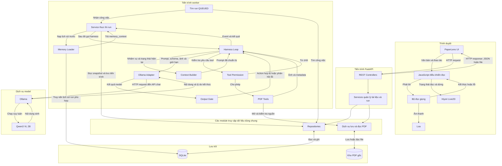

# PaperLens

PaperLens là ứng dụng review tài liệu PDF bằng AI Agent Harness, chạy trên máy local với FastAPI, SQLite và Ollama.

Người dùng upload PDF, chọn các trang cần xem và nhập yêu cầu. Harness điều khiển agent đọc ảnh từng trang, lưu kết quả riêng rồi ghép thành báo cáo. Giao diện hỗ trợ theo dõi thực thi, đối chiếu PDF, đọc báo cáo thành tiếng và duyệt xuất Markdown.

## 1. Chức năng

- CRUD hồ sơ tài liệu.
- Upload và quản lý các phiên bản PDF.
- Xem PDF nguồn ngay trên giao diện.
- CRUD cấu hình agent.
- Review từng trang PDF bằng model vision.
- Theo dõi trạng thái và lịch sử thực thi của run.
- Quản lý loop, tool, memory, context và permission.
- Lưu báo cáo từng trang và báo cáo chung.
- Xem trước, duyệt hoặc từ chối xuất Markdown.
- Đọc báo cáo bằng giọng của trình duyệt.
- Hiển thị Hiyori Live2D với chuyển động miệng theo trạng thái đọc.

Luồng hiện tại sử dụng một agent PDF Reviewer. RAG, so sánh paper liên quan và bộ xác minh bằng chứng độc lập chưa được triển khai.

## 2. Công nghệ

| Thành phần | Công nghệ |
|---|---|
| Backend API | FastAPI |
| HTTP server | Uvicorn |
| Kiểm tra dữ liệu | Pydantic 2 |
| ORM | SQLAlchemy 2 |
| Database | SQLite |
| Đọc và render PDF | PyMuPDF |
| Giao tiếp model | HTTPX và Ollama Adapter |
| Runtime AI | Ollama |
| Model AI | `qwen3-vl:2b-instruct` |
| Giao diện | HTML, CSS, JavaScript |
| Đọc văn bản | Web Speech API |
| Nhân vật | Hiyori Momose Live2D |
| Hiển thị Live2D | PixiJS 6.5.10 và pixi-live2d-display 0.4.0 |

Ollama là phần mềm chạy model. Qwen3-VL là model xử lý văn bản và hình ảnh. Hiyori là nhân vật giao diện, không phải một AI agent khác.

## 3. Kiến trúc hệ thống

PaperLens gồm ba tiến trình chính: FastAPI, worker Python và Ollama. Trình duyệt giao tiếp với FastAPI để quản lý tài liệu, tạo run và lấy kết quả.

FastAPI và worker sử dụng chung các module nghiệp vụ, repository và database SQLite. Worker chủ động tìm công việc đang chờ; database không tự khởi động hoặc thực thi run.



### Trách nhiệm của các thành phần

| Thành phần | Trách nhiệm |
|---|---|
| PaperLens UI | Nhập yêu cầu, upload PDF, theo dõi run và hiển thị báo cáo |
| REST Controllers | Nhận HTTP request và trả HTTP response |
| Services | Kiểm tra nghiệp vụ, tạo snapshot và phối hợp xử lý |
| Repositories | Đọc và ghi dữ liệu bằng SQLAlchemy |
| SQLite | Lưu tài liệu, phiên bản, cấu hình agent, run, event và báo cáo |
| Kho PDF | Giữ nội dung file PDF gốc |
| Worker | Tìm và nhận run đang ở trạng thái `QUEUED` |
| Memory Loader | Lấy lịch sử yêu cầu phù hợp từ các run trước |
| Harness Loop | Điều phối từng trang, lượt gọi model và giới hạn thực thi |
| Context Builder | Chuẩn bị đầu vào trước mỗi lần gọi model |
| Output Gate | Kiểm tra định dạng, schema, pha và tham chiếu trang |
| Tool Permission | Kiểm tra quyền trước khi thực thi tool |
| PDF Tools | Render trang PDF thành ảnh |
| Ollama Adapter | Chuyển đổi dữ liệu và giao tiếp HTTP với Ollama |
| Ollama | Nạp và chạy model Qwen |
| Qwen3 VL 2B | Xử lý prompt, ảnh và sinh hành động hoặc báo cáo |
| Bộ đọc giọng và Hiyori | Trình bày báo cáo bằng âm thanh và nhân vật 2D |

### Thứ tự thực thi

1. UI gửi yêu cầu tạo run tới FastAPI.
2. Service kiểm tra dữ liệu, chuẩn bị snapshot và lưu run `QUEUED`.
3. Worker tìm và nhận run, chuyển trạng thái sang `RUNNING`.
4. Service thực thi đọc snapshot và nạp memory nếu được bật.
5. Khi nạp memory xong, service mới gọi harness loop.
6. Loop chuẩn bị context, gọi model và kiểm tra đầu ra.
7. Nếu model yêu cầu tool hợp lệ, harness kiểm tra quyền rồi render ảnh trang.
8. Model nhận ảnh và viết báo cáo riêng của trang hiện tại.
9. Harness lưu báo cáo trang trước khi chuyển sang trang tiếp theo.
10. Python ghép báo cáo; service lưu kết quả và trạng thái cuối.
11. UI lấy trạng thái và kết quả qua API.

Các khối trong sơ đồ biểu diễn trách nhiệm và kết nối, không có nghĩa tất cả đều chạy song song. Trong một run hiện tại, memory được nạp trước loop; context được chuẩn bị trước từng lượt gọi model.

### Agent và phần trình bày báo cáo

PDF Reviewer là Qwen kết hợp vai trò, instruction, cấu hình và giao thức hành động JSON. Harness kiểm soát cách agent sử dụng dữ liệu và công cụ.

Bộ đọc giọng sử dụng văn bản báo cáo đã có. JavaScript điều khiển miệng Hiyori theo trạng thái đọc hoặc dừng; chưa phân tích âm thanh để khớp miệng.

Permission xuất báo cáo được xử lý riêng ở service xuất: người dùng xem trước và duyệt hoặc từ chối, sau đó backend kiểm tra hash và ghi event.

FastAPI và worker là hai tiến trình riêng. Worker chủ động truy vấn hàng chờ trong SQLite; SQLite không tự thực thi run.

### Thành phần harness

| Thành phần | Trách nhiệm |
|---|---|
| Loop | Điều phối từng trang, giới hạn lượt và thời gian |
| PDF Tools | Đọc thông tin PDF và render ảnh trang |
| Memory Loader | Lấy lịch sử yêu cầu phù hợp từ các run trước |
| Context Builder | Ghép instruction, trạng thái, lịch sử và ngân sách token |
| Permission | Kiểm tra tool, phạm vi trang và quyền xuất |
| Output Gate | Kiểm tra JSON, schema, pha và tham chiếu trang |
| Event Recorder | Lưu diễn biến thực thi |
| Report Composer | Ghép báo cáo từng trang bằng Python |
| Ollama Adapter | Chuẩn hóa giao tiếp HTTP với Ollama |

Memory được nạp trước khi bắt đầu loop. Context được chuẩn bị lại trước mỗi lần gọi model.

## 4. Luồng xử lý

1. Người dùng tạo hồ sơ tài liệu và upload PDF.
2. Backend lưu file, metadata và SHA-256.
3. Người dùng chọn agent, phiên bản, trang và instruction.
4. API lưu run `QUEUED` cùng snapshot cấu hình và nguồn.
5. Worker nhận run và chuyển sang `RUNNING`.
6. Service nạp memory phù hợp.
7. Harness xử lý lần lượt từng trang:
   - `READING`: model yêu cầu tool xem trang.
   - Harness kiểm tra quyền và render ảnh.
   - `PAGE_REVIEW`: model viết báo cáo từ ảnh hiện tại.
   - Harness lưu `page_review_saved` trước khi chuyển trang.
8. Python ghép các báo cáo từng trang.
9. Service lưu kết quả và trạng thái cuối.
10. UI lấy trạng thái, event và báo cáo qua API.

Mỗi trang cần tối thiểu hai lượt gọi model:

```text
Số lượt tối thiểu = số trang × 2
```

Ví dụ năm trang cần tối thiểu 10 lượt. Với `max_steps = 12`, còn hai lượt dự phòng cho cả run.

## 5. Cấu trúc mã nguồn

Các đường dẫn bên dưới tính từ thư mục `backend`.

| Đường dẫn | Nội dung |
|---|---|
| `app/main.py` | Khởi tạo FastAPI và đăng ký router |
| `app/controllers/` | REST endpoints |
| `app/services/` | Xử lý nghiệp vụ |
| `app/repositories/` | Truy cập database |
| `app/models/` | SQLAlchemy models |
| `app/schemas/` | Request và response schemas |
| `app/harness/loop.py` | Loop review từng trang |
| `app/harness/config.py` | Cấu hình agent |
| `app/harness/actions.py` | Schema hành động và báo cáo |
| `app/harness/pdf_tools.py` | Công cụ PDF |
| `app/harness/memory.py` | Truy xuất memory |
| `app/harness/permissions.py` | Chính sách quyền |
| `app/harness/worker.py` | Nhận và xử lý run |
| `app/adapters/ollama_adapter.py` | Giao tiếp Ollama |
| `app/review_worker.py` | Điểm chạy worker |
| `app/static/harness.html` | Giao diện |
| `app/static/hiyori.js` | Điều khiển Live2D |
| `paperlens.db` | SQLite database |
| `storage/documents/` | PDF được upload |

## 6. Yêu cầu môi trường

- Windows và PowerShell.
- Python 3.11.
- Ollama.
- Trình duyệt hỗ trợ JavaScript và WebGL.
- Đủ RAM và dung lượng đĩa cho model, môi trường Python và PDF.

Giọng tiếng Việt phụ thuộc giọng có sẵn trên thiết bị và trình duyệt. GPU có thể giúp tăng tốc nhưng cần đủ bộ nhớ và runtime tương thích.

## 7. Cài đặt

Các lệnh sau giả sử dự án được đặt tại `D:\paperlens`.

### 7.1. Lấy mã nguồn

Với máy chưa có dự án:

```powershell
git clone https://github.com/thanhdatvt11/paperlens.git D:\paperlens
Set-Location 'D:\paperlens'
```

Nếu đã có source thì sử dụng thư mục hiện tại.

### 7.2. Tạo môi trường Python

```powershell
Set-Location 'D:\paperlens'

py -3.11 -m venv .venv

& '.\.venv\Scripts\python.exe' -m pip install --upgrade pip
```

### 7.3. Cài dependency

Nếu repository có file lock hoặc requirements đã kiểm chứng, ưu tiên dùng file đó. Với source còn các import hiện tại:

```powershell
Set-Location 'D:\paperlens\backend'

& 'D:\paperlens\.venv\Scripts\python.exe' -m pip install `
  fastapi 'uvicorn[standard]' 'sqlalchemy>=2,<3' `
  'pydantic>=2,<3' PyMuPDF python-multipart httpx `
  alembic 'markitdown[pdf]'
```

MarkItDown không thực hiện bước đọc của luồng vision hiện tại, nhưng một số module cũ vẫn import thư viện này.

### 7.4. Cài model Ollama

Cài Ollama từ:

https://ollama.com/download/windows

Sau đó chạy:

```powershell
ollama pull qwen3-vl:2b-instruct
ollama list
ollama run qwen3-vl:2b-instruct 'Reply only OK.'
```

Kiểm tra dịch vụ:

```powershell
Invoke-RestMethod 'http://127.0.0.1:11434/api/tags'
```

Ollama trên Windows có thể đã chạy nền. Không mở thêm `ollama serve` nếu dịch vụ đang hoạt động.

### 7.5. Cấu hình backend

Tạo file `backend/.env`:

```dotenv
OLLAMA_BASE_URL=http://127.0.0.1:11434
OLLAMA_MODEL=qwen3-vl:2b-instruct
OLLAMA_VISION_MODEL=qwen3-vl:2b-instruct
```

`OLLAMA_BASE_URL` là địa chỉ Python gọi đến. Nó khác `OLLAMA_HOST`, biến cấu hình địa chỉ Ollama server/CLI.

Không commit `.env` chứa cấu hình riêng. Có thể cung cấp `.env.example`.

### 7.6. Khởi tạo database cho cài mới

Nếu database và bảng đã tồn tại thì không cần chạy lại. Từ thư mục `backend`:

```powershell
@'
from app.core.database import Base, engine
from app.models.document import Document, DocumentVersion
from app.models.harness_agent import HarnessAgent
from app.models.harness_run import HarnessRun, HarnessRunEvent

Base.metadata.create_all(bind=engine)
print("Database tables ready")
'@ | & 'D:\paperlens\.venv\Scripts\python.exe' -
```

`create_all` tạo bảng chưa tồn tại, không thay thế migration khi cấu trúc bảng đã thay đổi.

### 7.7. Tài nguyên Live2D

Giao diện sử dụng các file:

```text
app/static/vendor/pixi.min.js
app/static/vendor/live2dcubismcore.min.js
app/static/vendor/cubism4.min.js
```

Model được đặt tại:

```text
app/static/models/hiyori/
```

Giữ đủ `.model3.json`, `.moc3`, textures, physics và motion theo bộ runtime.

Nguồn tải:

- Hiyori: https://www.live2d.com/en/learn/sample/momose-hiyori/
- Cubism Core: https://www.live2d.com/en/sdk/download/web/

Bộ hiển thị hiện tại dùng PixiJS 6.5.10, pixi-live2d-display 0.4.0 và Core từ nhánh Cubism 5.2 đã lựa chọn. Không tự thay bằng Core Latest; đã gặp lỗi render khi dùng Core 6 với thư viện cũ.

Tuân thủ điều khoản sử dụng tài nguyên Live2D khi sử dụng hoặc phân phối.

## 8. Chạy ứng dụng

### Terminal 1 — FastAPI

```powershell
Set-Location 'D:\paperlens\backend'

& 'D:\paperlens\.venv\Scripts\python.exe' `
  -m uvicorn app.main:app --reload
```

### Terminal 2 — Worker

```powershell
Set-Location 'D:\paperlens\backend'

& 'D:\paperlens\.venv\Scripts\python.exe' -m app.review_worker
```

Chỉ chạy một worker trong thiết kế hiện tại. Worker khởi động có cơ chế đánh dấu run `RUNNING` cũ là bị gián đoạn.

### Địa chỉ sử dụng

| Địa chỉ | Chức năng |
|---|---|
| http://127.0.0.1:8000/harness | Giao diện |
| http://127.0.0.1:8000/docs | Swagger |
| http://127.0.0.1:8000/api/v1/health | Kiểm tra API |

Uvicorn `--reload` chỉ phục vụ phát triển. Khi sửa code worker hoặc hằng số được worker import, cần khởi động lại worker.

## 9. Cấu hình agent mẫu

Tạo hoặc sửa PDF Reviewer ở tab **Cấu hình agent**:

```json
{
  "name": "PDF Reviewer",
  "model": "qwen3-vl:2b-instruct",
  "voice": "teacher",
  "max_steps": 12,
  "memory_enabled": true,
  "tools": ["pdf_info", "view_pdf_page", "save_report"],
  "permission": {
    "report_export": "ask"
  },
  "context": {
    "num_ctx": 8192,
    "num_predict": 3072,
    "recent_messages": 6
  }
}
```

- `voice`: phong cách viết, không phải giọng âm thanh.
- `max_steps`: số lần gọi model tối đa trong run.
- `num_ctx`: ngân sách cửa sổ context.
- `num_predict`: giới hạn token sinh mỗi lần gọi.
- `memory_enabled`: bật truy xuất lịch sử yêu cầu phù hợp.
- `report_export`: yêu cầu duyệt hoặc từ chối xuất.

Run cũ giữ snapshot; thay cấu hình chỉ ảnh hưởng run mới.

## 10. Hướng dẫn sử dụng

1. Mở tab **Tài liệu và PDF**, tạo hồ sơ tài liệu.
2. Upload PDF để tạo version.
3. Bấm **Xem PDF** để kiểm tra nguồn.
4. Bấm **Chọn review**.
5. Chọn agent, nhập trang và instruction.
6. Bắt đầu với một trang, sau đó thử `2-3`.
7. Tạo run và theo dõi lịch sử thực thi.
8. Mở event `page_review_saved` để xem kết quả từng trang.
9. Đối chiếu báo cáo với PDF nguồn.
10. Chọn đọc báo cáo hoặc xem trước và duyệt xuất Markdown.

Nút **Dừng cập nhật** chỉ dừng việc cập nhật UI, không hủy công việc trong worker.

## 11. Tool và giới hạn quyền

| Tool hoặc hành động | Chức năng |
|---|---|
| `pdf_info` | Đọc thông tin PDF; có trong PDFTools |
| `view_pdf_page` | Render một trang thành ảnh |
| `save_report` | Hành động xuất báo cáo theo permission |

Loop từng trang hiện yêu cầu `view_pdf_page` cho trang đang xử lý. `save_report` được xử lý ở luồng xuất sau khi người dùng yêu cầu, không cho model tự chọn đường dẫn ghi file.

Harness kiểm tra phạm vi trang và quyền trước khi chạy tool. Nội dung trong PDF và memory được coi là dữ liệu, không phải chỉ dẫn hệ thống.

## 12. REST API chính

Prefix: `/api/v1`.

| Nhóm | Endpoints |
|---|---|
| Documents | POST/GET `/documents`; GET/PUT/DELETE `/documents/{id}` |
| Versions | POST/GET `/documents/{id}/versions` |
| PDF nguồn | GET `/documents/{id}/versions/{vid}/file` |
| Agents | POST/GET `/agents`; GET/PUT/DELETE `/agents/{id}` |
| Tạo run | POST `/harness-runs` |
| Trạng thái | GET `/harness-runs/{id}` |
| Event | GET `/harness-runs/{id}/events` |
| Xuất báo cáo | GET/POST `/harness-runs/{id}/report-export` |

Upload version dùng `multipart/form-data`, trường file tên `upload`.

Ví dụ tạo run; thay các ID bằng dữ liệu thực tế:

```json
{
  "agent_id": 1,
  "document_id": 11,
  "version_id": 11,
  "pages": [2, 3],
  "instruction": "Tóm tắt từng trang. Không đủ bằng chứng thì findings rỗng."
}
```

## 13. Lưu trữ và event

| Dữ liệu | Vị trí |
|---|---|
| Database | `backend/paperlens.db` |
| PDF gốc | `backend/storage/documents/` |
| Cấu hình agent | Bảng `harness_agents` |
| Run và kết quả cuối | Bảng `harness_runs` |
| Lịch sử thực thi | Bảng `harness_run_events` |

Kết quả từng trang có trong event `page_review_saved`. Khi hoàn tất, chúng được lưu thêm trong `result.page_reports`.

Event giúp theo dõi tiến trình, tìm lỗi và kiểm tra hành động. Event không chứa suy nghĩ nội bộ của model và không tự tạo khả năng resume.

Không xóa PDF trực tiếp khỏi kho khi database vẫn còn version tham chiếu.

## 14. Giọng đọc và Hiyori

JavaScript lấy báo cáo đã có và dùng `speechSynthesis` để phát lời.

Phần điều khiển đọc cập nhật class `speaking`; `hiyori.js` dùng trạng thái này để thay đổi `ParamMouthOpenY`.

Hiện tại:

- Không gọi Qwen để tạo giọng nói.
- Miệng chuyển động minh họa theo trạng thái đọc.
- Chưa có lip sync theo âm lượng hoặc âm vị.
- Giọng trực tuyến có thể cần Internet và gửi văn bản tới dịch vụ giọng nói.

## 15. Xử lý lỗi

| Lỗi | Kiểm tra và xử lý |
|---|---|
| Run ở `QUEUED` | Kiểm tra worker đã chạy đúng thư mục và môi trường |
| Không kết nối Ollama | Kiểm tra `/api/tags` và `OLLAMA_BASE_URL` |
| PDF vượt giới hạn trang | Kiểm tra `MAX_PAGE_COUNT`, lưu và restart worker |
| `Model output truncated` | Kiểm tra lý do kết thúc; giữ output ngắn và retry có giới hạn |
| Tóm tắt nhiều trang bị lẫn | Kiểm tra loop lưu từng trang trước khi thay ảnh |
| Hiyori không hiện | Kiểm tra Console, đường dẫn tài nguyên và phiên bản Core |
| UI không nhận thay đổi | Lưu tất cả và nhấn Ctrl+F5 |
| HTTP 500 | Xem traceback trong terminal FastAPI |
| GitHub chặn file lớn | Không commit môi trường Python, model OCR và bản sao lưu |

`max_steps` không thay thế `num_predict`: tăng số lượt không làm mỗi output được dài hơn.

## 16. Giới hạn hiện tại

- Model có thể đọc sai và tạo nhận xét thiếu bằng chứng.
- Kiểm tra schema không xác minh độ chính xác nội dung.
- Chưa có đánh giá nhất quán toàn tài liệu bằng bằng chứng liên trang.
- `max_steps` hiện tối đa 12, tương ứng tối đa sáu trang nếu không có lượt sửa.
- Báo cáo chung giới hạn hai findings; kết quả riêng còn trong `page_reports`.
- Memory chủ yếu giữ lịch sử yêu cầu, chưa phải kho kiến thức xác minh.
- Chưa có resume tự động, hủy job hoặc điều phối nhiều worker.
- Chưa có xóa version và xóa dây chuyền tài liệu.
- Chưa có xác thực nhiều người dùng hoặc cấu hình production.

## 17. Quản lý mã nguồn

Không commit:

- `.venv` và các môi trường thử nghiệm.
- Model OCR tải về.
- `.env` riêng.
- Database SQLite.
- PDF người dùng upload.
- ZIP sao lưu và cache.

Giữ mã nguồn UI, harness và tài nguyên được phép phân phối. Git không tự sao lưu những file đã bị ignore.

Trước khi push:

```powershell
git status
git diff --cached --stat
git diff --cached --name-only
```

## 18. Tài liệu tham khảo

- FastAPI: https://fastapi.tiangolo.com/
- Ollama: https://docs.ollama.com/
- Qwen3-VL: https://ollama.com/library/qwen3-vl
- PyMuPDF: https://pymupdf.readthedocs.io/
- Web Speech API: https://developer.mozilla.org/en-US/docs/Web/API/SpeechSynthesis
- Live2D: https://www.live2d.com/
- pixi-live2d-display: https://guansss.github.io/pixi-live2d-display/
